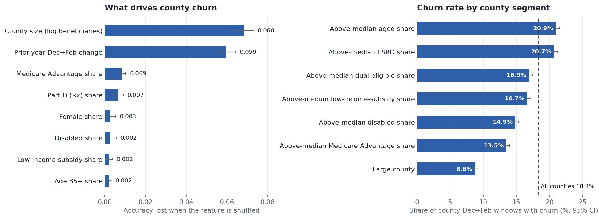

# Churn Prediction

Two churn projects with the same question at different scales: who is about to
leave? One predicts churn for whole U.S. counties from public Medicare
enrollment data. The other predicts churn for individual Netflix subscribers.

| Project | Scale | Data | Model | Headline result |
|---|---|---|---|---|
| [Medicare County-Level Churn](medicare-churn/) (hackathon) | 3,289 U.S. counties, 2013–2025 | CMS Medicare Monthly Enrollment (563k rows) | Random Forest + statistical tests, PySpark on Databricks | ROC-AUC 0.85 on a held-out year; 3,278 counties forecast for Dec 2025 → Feb 2026 |
| [Netflix Customer Churn](netflix-churn/) | 5,000 subscribers | Kaggle Netflix churn dataset (14 features) | 6 classifiers benchmarked | Gradient Boosting 99.1% test accuracy |



## What's in each folder

**[`medicare-churn/`](medicare-churn/)** is a full pipeline. It cleans 13 years of
county-level CMS data, resolves ~3.2M suppressed cells, engineers coverage and
demographic ratios, labels churn as a >0.5% enrollment drop from December to
February, trains a class-balanced Random Forest on a time-based split, backs up
its drivers with z-tests and correlation, and builds Plotly dashboards. The
cleaning and feature stage also runs in PySpark on Databricks with Delta tables.

**[`netflix-churn/`](netflix-churn/)** is a notebook project. It covers EDA,
encoding, scaling and outlier treatment, then compares Logistic Regression,
KNN, Naive Bayes, Decision Tree, Random Forest and Gradient Boosting, with
feature importance for the churn drivers. Written PDF reports for the data and
modelling stages are included.

## Run them

```bash
git clone https://github.com/HiralR2931/churn-prediction.git
cd churn-prediction/medicare-churn
pip install -r requirements.txt
# download the CMS CSV into data/ (link in medicare-churn/README.md)
python run_pipeline.py
```

For Netflix, download `netflix_customer_churn.csv` from
[Kaggle](https://www.kaggle.com/datasets/abdulwadood11220/netflix-customer-churn-dataset)
and open `netflix-churn/NetflixdataTesting.ipynb` in Jupyter or Google Colab.

Neither dataset is stored in this repo.

## Stack

Python · pandas · NumPy · scikit-learn · SciPy · Plotly · Matplotlib/Seaborn · PySpark · Databricks · Jupyter

**Author:** Hiral Rana · [GitHub](https://github.com/HiralR2931) · [LinkedIn](https://linkedin.com/in/ranahiral)
