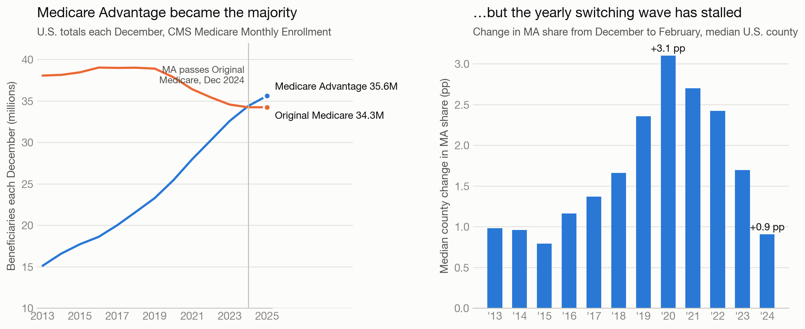
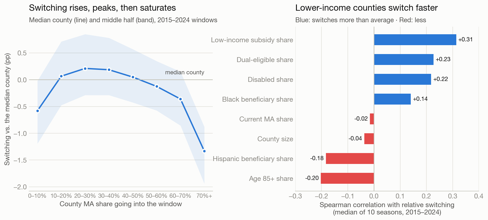
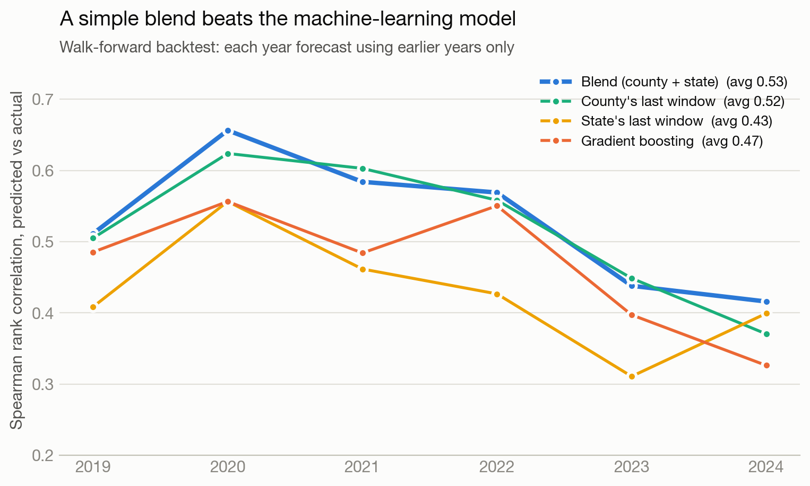
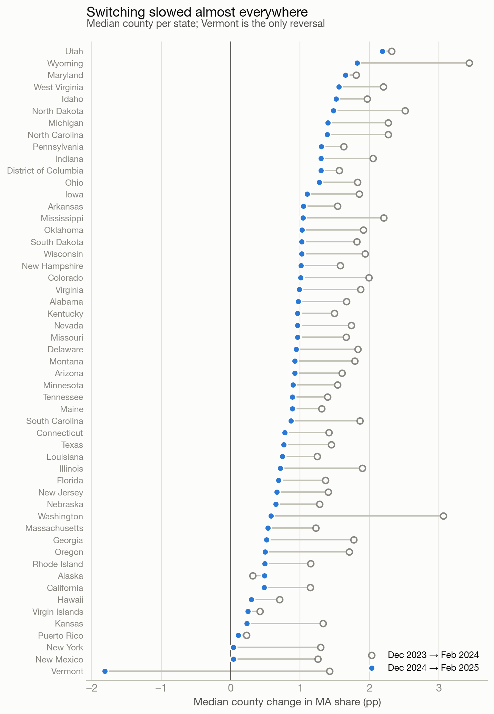

# The Medicare Advantage Stall

**County-level analysis of who leaves Original Medicare for Medicare Advantage, 2013–2025.**

Medicare Advantage (MA), the private-plan alternative to Original Medicare, passed
half of all beneficiaries in December 2024. This project measures that shift
county by county from 13 years of CMS enrollment data. It finds that the yearly
switching wave peaked in 2020 and has since fallen by more than two thirds, and
it tests which methods can forecast where switching will be fastest next.

**[Open the interactive report →](https://hiralr2931.github.io/churn-prediction/)**
It has a county map for every season, the backtest, and a searchable Dec 2025 → Feb 2026 outlook.

*Started as a hackathon project.* Part of the [churn-prediction](../) repo.

**Stack:** Python · pandas · scikit-learn · SciPy · Matplotlib · D3 · PySpark (Databricks)



## Key findings

| | Finding | Number |
|---|---|---|
| 1 | **MA became the majority.** Its share of beneficiaries rose every year, and MA passed Original Medicare in Dec 2024. | 28.4% (2013) → **51.0%** (2025) |
| 2 | **Switching stalled.** The median county's December → February gain in MA share peaked in 2020, then fell. | +3.1 pp (2020) → **+0.9 pp** (2024) |
| 3 | **The slowdown was nearly universal.** Counties that switched more slowly than the season before. In 9% of counties MA share fell. | **87%** of 2,963 counties |
| 4 | **Switching follows an adoption curve.** It is slowest where MA is rare, fastest at 20–40% MA share, and well below average once MA passes 70%. | **−1.3 pp** vs. the median county above 70% |
| 5 | **Lower-income counties switch faster.** Low-income-subsidy share is the strongest correlate, positive in all 10 seasons; older (85+) counties switch more slowly in all 10. | Median Spearman ρ **+0.31** / −0.20 |
| 6 | **Vermont reversed.** It was the only state where the median county's MA share fell in Dec 2024 → Feb 2025. | **−1.8 pp** |
| 7 | **A simple blend beats machine learning.** Ranking counties by half their own last season plus half their state's beat gradient boosting on 12 features. | Spearman **0.53** vs. 0.47 |



## How switching is measured

Plan choices made during the October–December enrollment period take effect on
January 1. CMS publishes enrollment counts, not individual transitions, so the
project measures the season's net effect:

> **switching** = MA share in February (Y+1) − MA share in December (Y), in percentage points

The overall pace swings with the insurance market, and county data cannot
predict it. Forecasting therefore targets **relative switching**: a county's
value minus the median county's value that season. National shares and totals
use CMS's national rows; county figures sum to about 0.5 million fewer people,
because some beneficiaries have no county on file. Counties with fewer
than 1,000 beneficiaries are excluded from the statistics and models, because
a handful of people moves them by several points.

## Forecasting: can we tell which counties lead?

Four methods were compared in a **walk-forward backtest** for each season from
2019 to 2024. Each method is trained or calibrated only on earlier seasons.

| Method | Avg. Spearman | Top-10% switchers caught | Seasons ranked best |
|---|---|---|---|
| **Blend: ½ county's last season + ½ state's last season** | **0.53** | 29% | 4 of 6 |
| County's last season | 0.52 | 30% | 2 of 6 |
| Gradient boosting (12 demographic + trend features) | 0.47 | 27% | 0 of 6 |
| State's last season | 0.43 | 19% | 0 of 6 |



Switching repeats where it happened last year and moves with the state's
insurance market. Demographics add little on top. Every method scored lower in
the 2023 and 2024 seasons, when the national slowdown began. The blend is used
for the **Dec 2025 → Feb 2026 outlook** (2,971 counties:
370 ahead of the median county, 446 behind), saved in
`outputs/reports/ma_forecast_dec2025_feb2026.csv`.

<details>
<summary>State by state: switching slowed in 52 of 53 states and territories</summary>



</details>

## The original question: net enrollment decline

The project began as a classifier for counties whose **total** enrollment drops
more than 0.5% from December to February. That model is still in the pipeline.
A class-balanced Random Forest on a time-based split scores **ROC-AUC 0.85 and
PR-AUC 0.50** on the held-out Dec 2024 → Feb 2025 season (base rate 16%; churn
recall 0.82, precision 0.36).

Two lessons from building it shaped the project:

- **A feature bug.** `prior_window_change` was documented as last year's
  Dec → Feb change but was computed as the 12-month change. After the fix it
  became the model's top driver, and PR-AUC rose from 0.46 to 0.50.
- **The label mostly measures county size.** The smallest fifth of counties
  are labelled "churn" in 41% of seasons, the largest fifth in 7%. In a county
  of 1,000, a 0.5% drop is five people. Switching is a more meaningful outcome:
  it reflects how people choose coverage, not how many people are enrolled.

## Run it

```bash
pip install -r requirements.txt
# download the CMS extract (see Data note) to data/medicare_enrollment_2013_2025.csv
python run_pipeline.py
python -m http.server --directory site 8000   # then open http://localhost:8000
```

The full run takes about 30 seconds on a laptop. Single stages run on their own too, e.g.
`python -m src.ma_switching` or `python -m src.charts`.

## Project layout

```
medicare-churn/
├── run_pipeline.py              # end-to-end orchestrator
├── src/
│   ├── config.py                # paths, windows, feature lists, model params
│   ├── data_cleaning.py         # load, resolve suppressed cells, validate
│   ├── feature_engineering.py   # composition ratios + trend features
│   ├── ma_switching.py          # switching table, findings, backtest, outlook
│   ├── charts.py                # README charts (docs/*.png)
│   ├── web_report.py            # data for the interactive report (site/data.js)
│   ├── churn_label.py           # net-decline label + temporal split
│   ├── model.py                 # Random Forest train / eval / importance / forecast
│   ├── stats_analysis.py        # segment z-tests + point-biserial correlation
│   └── dashboards.py            # Plotly figures (outputs/figures/)
├── site/                        # interactive report, published with GitHub Pages
├── notebooks/                   # PySpark/Databricks versions of the pipeline
├── docs/                        # README charts
├── data/                        # place the CMS CSV here (git-ignored)
└── outputs/reports/             # every table behind the findings (CSV/JSON)
```

## Databricks

`notebooks/medicare_churn_databricks.py` runs the cleaning and feature-engineering
stage in PySpark, on Databricks. It handles suppressed cells, runs validation checks,
builds windowed trend features and writes a Delta table.
`medicare_churn_ALLINONE_databricks.py` runs the net-decline pipeline in one notebook.

## Data note

The CMS [Medicare Monthly Enrollment](https://data.cms.gov/summary-statistics-on-beneficiary-enrollment/medicare-and-medicaid-reports/medicare-monthly-enrollment)
file is public (download the full CSV; ~564k rows). CMS suppresses counts of
1–10 with `*`; this project imputes them at 5. Each state's "Unknown"
county bucket (FIPS ending 999) is left out of county analysis. All measures
are net county snapshots. "MA" is CMS's "Medicare Advantage and other health
plans" count, which includes a few cost plans and PACE. Switching also moves when people join or leave Medicare, and when
plans close mid-year. The correlations describe associations, not causes.
Connecticut replaced its 8 counties with 9 planning regions in 2022. Its
Dec 2021 → Feb 2022 season can't be measured, its first seasons as regions
have no history for the forecasters, and it is missing from the map. It is in
every other statistic.
