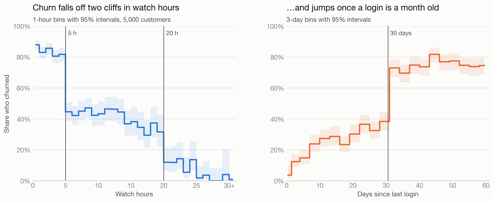
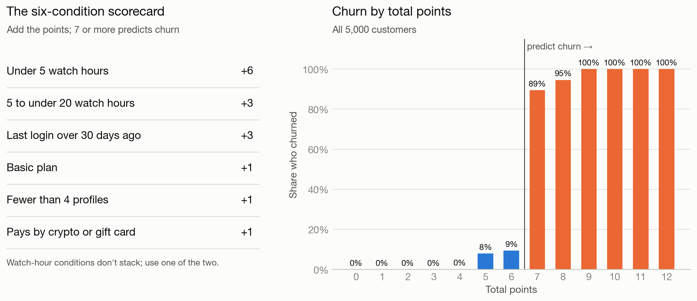
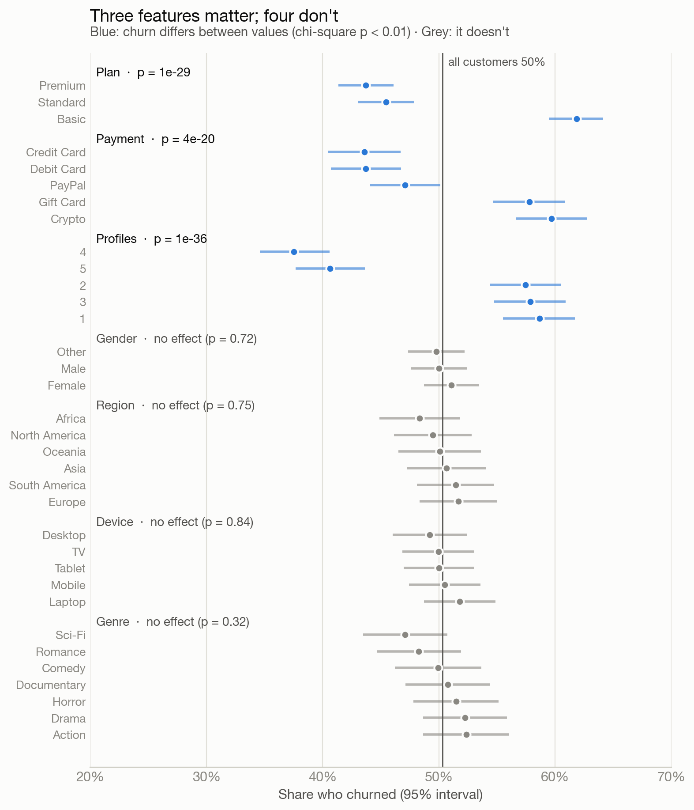
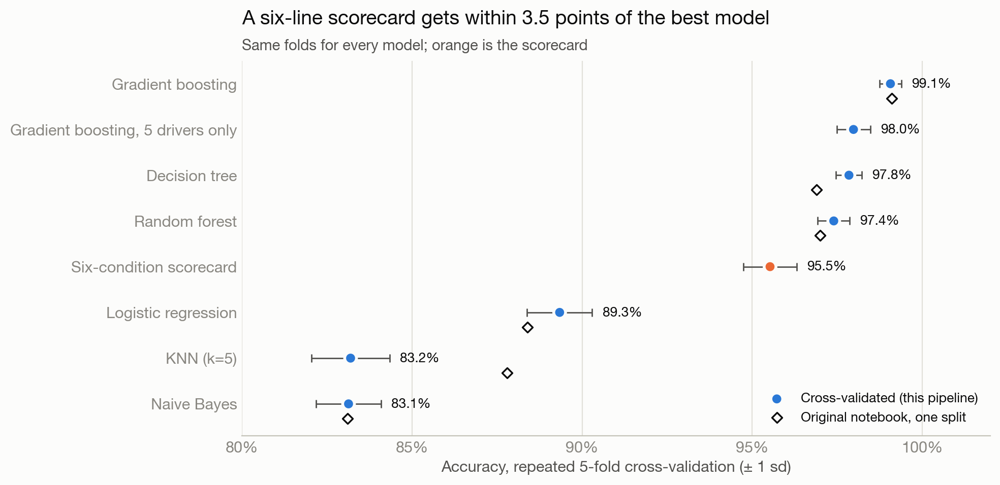

# The Six-Line Churn Rule

**What really drives churn in the Kaggle Netflix customer dataset, and why 99% accuracy isn't the headline.**

This dataset is a common churn-modelling exercise, and gradient boosting scores
99.1% on it. Churn here is not subtle. Six yes-or-no conditions about viewing,
logins and the account predict it for **95.5%** of customers. Gender, age, region,
device and genre play no part at all. This project finds that rule, tests it
against six classifiers on equal terms, and fixes the bugs in the original
notebook.

**[Open the interactive report →](https://hiralr2931.github.io/churn-prediction/netflix/)**
It includes the cliffs, the scorecard calculator, the model benchmark and risk tiers.

Part of the [churn-prediction](../) repo.

**Stack:** Python · pandas · scikit-learn · SciPy · Matplotlib · D3



## Key findings

| | Finding | Number |
|---|---|---|
| 1 | **Churn falls off cliffs, not slopes.** It drops in steps at 5 and 20 watch hours and jumps once the last login is over 30 days old. | 82% → 45% at 5 h · 32% → 12% at 20 h |
| 2 | **Two habits nearly decide it.** Customers watching 30+ hours almost never churn; light watchers who haven't logged in for a month always do. | 3 of 367 · 873 of 873 |
| 3 | **Three account details matter; demographics don't.** Basic plan, crypto/gift-card payment and fewer than 4 profiles raise churn. Gender, age, region, device and genre show no effect. | chi-square p < 0.001 vs. p > 0.3 |
| 4 | **A six-condition scorecard reproduces it.** Add the points; 7 or more predicts churn. | **95.5%** held-out accuracy |
| 5 | **The scorecard is decisive at both ends.** | 1 of 1,406 churned at ≤4 points · 1,009 of 1,009 at ≥9 |
| 6 | **The best model only wins at the border.** 49 of gradient boosting's 50 errors are customers scoring 5–9, right around the cut-off. | 99.1% vs. 95.5% |

## The scorecard

| Condition | Points |
|---|---|
| Under 5 watch hours | +6 |
| 5 to under 20 watch hours | +3 |
| Last login over 30 days ago | +3 |
| Basic plan | +1 |
| Fewer than 4 profiles | +1 |
| Pays by crypto or gift card | +1 |
| **Predict churn at** | **7 or more** (maximum 12) |

The two watch-hour conditions don't stack. The points were found by searching small integers
for the highest accuracy, and the cut-points are where churn jumps in the data. No other
small integer weights for these six conditions do better. Because the cut-points were chosen
from the full dataset, the held-out 95.5% is very slightly optimistic. Scoring the fixed card on
all rows gives 95.6%.



| Risk tier | Points | Customers | Churned | Share of all churners |
|---|---|---|---|---|
| Low | 0–4 | 1,406 (28%) | 0.1% | 0% |
| Watch | 5–6 | 1,043 (21%) | 9% | 4% |
| High | 7–8 | 1,542 (31%) | 92% | 56% |
| Very high | 9+ | 1,009 (20%) | 100% | 40% |

The top two tiers hold half the customers and 96% of everyone who churned.



## Model benchmark

Every model is scored on the same **repeated stratified 5-fold cross-validation**
(3 repeats, 15 held-out folds). Logistic regression, KNN and Naive Bayes get one-hot
categories and scaled numbers. Tree models get ordinal codes. The scorecard is refit
on every training fold.

| Model | Features | Accuracy (± sd) | ROC-AUC | Original notebook |
|---|---|---|---|---|
| Gradient boosting | 12 | **99.1% ± 0.3** | 0.999 | 99.1% |
| Gradient boosting, 5 drivers only | 5 | 98.0% ± 0.5 | 0.997 | — |
| Decision tree | 12 | 97.8% ± 0.4 | 0.978 | 96.9% |
| Random forest | 12 | 97.4% ± 0.5 | 0.997 | 97.0% |
| **Six-condition scorecard** | 6 conditions | **95.5% ± 0.8** | 0.979 | — |
| Logistic regression | 12 | 89.3% ± 1.0 | 0.967 | 88.4% |
| KNN (k=5) | 12 | 83.2% ± 1.1 | 0.911 | 87.8% |
| Naive Bayes | 12 | 83.1% ± 1.0 | 0.946 | 83.1% |



The original 99.1% figure for gradient boosting holds up under cross-validation.
What changes is how to read it: it shows that the data follows a rule,
not that the model found something subtle.

## What changed from the original notebook

1. **A cleaning step corrupted 57 rows.** The notebook divided `avg_watch_time_per_day`
   by 10 wherever it exceeded 10, calling those entry errors. The column is
   `watch_hours / (last_login_days + 1)` in every row (to the 2 decimals it is stored with).
   The large values are customers who logged in within the last week (`last_login_days` ≤ 6).
   Undoing the change barely moves model accuracy, but the data is now used as published.
2. **Logistic regression and KNN weren't given a fair test.** They ran on label-encoded
   categories with no scaling, although the README said features were scaled. They now get
   one-hot categories and scaled numbers.
3. **One split became 15.** All results came from a single 80/20 split; they now come from
   repeated 5-fold cross-validation, with the spread across folds reported.
4. **A chart showed numbers no code produced.** One "validation accuracy" chart had
   an XGBoost model and scores typed in by hand. The benchmark above replaces it.
5. **The notebook is kept** (`NetflixdataTesting.ipynb`) as the original exploration. The
   pipeline below supersedes it.

## Run it

```bash
pip install -r requirements.txt
# download netflix_customer_churn.csv from Kaggle (link below) into data/
python run_pipeline.py
```

The full run takes about 20 seconds on a laptop: checks, analysis, benchmark, charts and `site/data.js`.

## Project layout

```
netflix-churn/
├── run_pipeline.py          # end-to-end orchestrator
├── src/
│   ├── config.py            # paths, features, scorecard conditions, CV settings
│   ├── data.py              # load + data checks (derived column, fee = plan)
│   ├── analysis.py          # feature tests, cliffs, interaction grid, scorecard, tiers
│   ├── models.py            # six classifiers + scorecard, repeated 5-fold CV
│   ├── charts.py            # README charts (docs/*.png)
│   └── web_report.py        # data for the interactive report (site/data.js)
├── site/                    # interactive report, published with GitHub Pages
├── docs/                    # README charts
├── outputs/reports/         # every table behind the findings (CSV/JSON)
├── data/                    # place the Kaggle CSV here (git-ignored)
├── NetflixdataTesting.ipynb # original notebook
└── *.pdf                    # original milestone reports
```

## Data note

The [Netflix Customer Churn Dataset](https://www.kaggle.com/datasets/abdulwadood11220/netflix-customer-churn-dataset)
on Kaggle has 5,000 rows, 14 columns, no missing values, and churn at 50.3%. It is
**synthetic**, not Netflix's records. The sharp thresholds, a derived column, a fee
fixed by plan, and five features with no effect all show it was generated from rules.
The findings describe this dataset only, and say nothing about real Netflix customers.

**Author:** Hiral Rana · MS Data Analytics Engineering, Northeastern University
